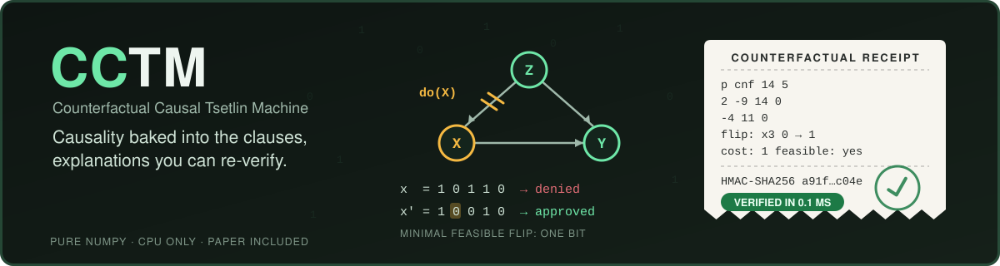

<div align="center">



<br/>

[](https://github.com/AnwarDebes/CCTM/releases)
[](pyproject.toml)
[](LICENSE)
[](tests/)
[](paper/cctm.pdf)

**A pure-Python reference implementation of CCTM v0.1, the sixth member of
the Tsetlin Machine family alongside TM, GTM, HTM, HGTM, and THGTM.**

▶ [Watch it in 45 seconds](https://anwardebes.github.io/shorts/#cctm)

</div>

---

CCTM bakes causality into training via three new primitives:

1. **Counterfactual data augmentation**: every sample $(x, y)$ is trained
   with an aligned CF partner $(x', y')$ from an external oracle.
2. **Type-III contrastive feedback**: running per-clause causal score
   and per-feature treatment effect, both first-class outputs.
3. **Structural counterfactual recourse with SAT receipts**: minimal
   feasibility-respecting flip sets derived from clause structure,
   packaged as DIMACS + HMAC certificates an auditor can re-verify in
   ~0.1 ms.

The accompanying paper is at `paper/cctm.pdf`.

## Quick start

```bash
pip install -e .
pytest -q tests/         # 14 unit tests, ~7 s
make reproduce           # all 3 experiments, ~60 s on CPU
make paper               # build paper/cctm.pdf
```

## What's in the box

| Path | What it is |
|---|---|
| `cctm/ta.py`         | Canonical Tsetlin Automaton bank (no trace; THGTM's ETTA is a separate variant). |
| `cctm/tm.py`         | Binary Tsetlin Machine wrapper used by every experiment. |
| `cctm/causal.py`     | **CCTM core**: Type-III feedback, causal score, treatment effect, causal influence. |
| `cctm/recourse.py`   | Exact and greedy structural recourse with feasibility constraints. |
| `cctm/receipts.py`   | Signed DIMACS+HMAC counterfactual receipts and offline verification. |
| `cctm/data.py`       | Bundled synthetic SCM and loan-denial datasets. |
| `tests/`             | 14 unit tests, all green. |
| `experiments/synthetic_scm.py`    | ATE recovery vs vanilla TM. |
| `experiments/loan_recourse.py`    | Recourse quality + receipt verification. |
| `experiments/fairness_audit.py`   | Bias recovery + biased-clause audit. |
| `scripts/make_figures.py`         | Builds every figure from `results/*.json`. |
| `paper/cctm.tex`, `references.bib`| Paper source. |
| `paper/figures/*.pdf`             | Figures from real experiment data. |
| `results/*.json`                  | Raw per-seed records. |

## Headline results

| Experiment | Vanilla TM | CCTM |
|---|---|---|
| Synthetic SCM ATE Pearson (pred-flip) | $0.895$ | $\mathbf{0.918}$ |
| Loan recourse success | $1.000$ | $1.000$ (tied) |
| Loan recourse latency (ms) | $0.14$ | $0.14$ (tied) |
| Fairness: accuracy vs clean truth | $0.817 \pm 0.092$ | $\mathbf{0.966 \pm 0.015}$ |
| Fairness: demographic parity | $0.181 \pm 0.131$ | $\mathbf{0.041 \pm 0.021}$ |
| Fairness + clause audit DP | n/a | $\mathbf{0.019 \pm 0.016}$ |
| CF receipts verified (60 attempts) | n/a | $\mathbf{60 / 60}$ |

See `paper/cctm.pdf` for the full discussion, limitations and the
regulatory framing (EU AI Act Article 86 effective 2 Aug 2026, GDPR
Article 22, US ECOA).

## Honest limitations

- CCTM conditions on an external CF oracle; it does NOT learn a causal
  DAG.  Full do-calculus is future work.
- Single-feature interventions only in v0.1.
- The loan and SCM experiments are synthetic (bundled).  Real-world
  evaluation (Adult-Income, COMPAS) is future work.
- On clean loan data CCTM and vanilla TM tie on recourse quality.  The
  CCTM advantage shows up under biased data (fairness audit experiment).
- No federated / differentially-private aggregation story.

## License

MIT.

## Citing

```bibtex
@misc{debes2026cctm,
  title  = {CCTM: A Counterfactual Causal Tsetlin Machine for
            Regulatorily-Compliant Individual Decision Explanations},
  author = {Debes, Anwar},
  year   = {2026},
  note   = {Reference implementation, v0.1, May 2026}
}
```
